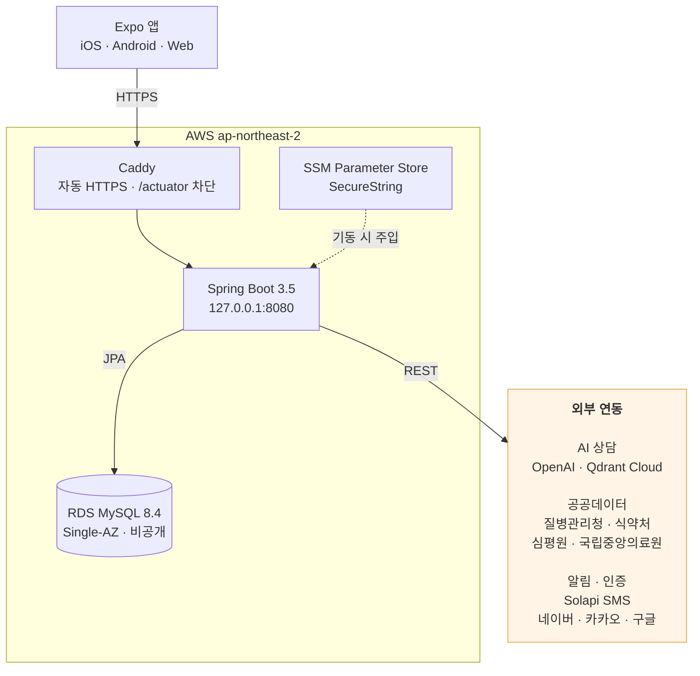
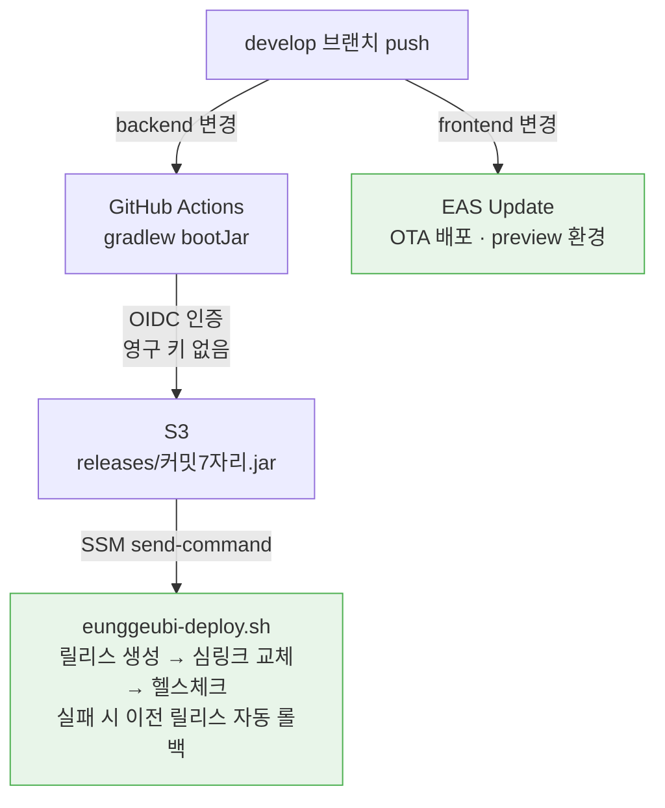

# 응급이 (eunggeubi)

급할 때 뭘 해야 할지 모르는 순간을 위한 앱 — 증상을 적으면 질병관리청 자료를 근거로 참고정보를 안내하고, 가까운 응급실의 남은 병상·약물 병용 확인·119 호출·보호자 자동 알림까지 한 흐름으로 이어집니다.

## 프로젝트 소개

**개발 기간** · 2026.07.03 ~ 진행 중
**진행** · 동아리 타닥타닥
**팀** · 6인 (백엔드 · 프론트엔드)

<!-- 기획 배경: 타겟 사용자 확정 후 변경 가능. 회의 후 최종 확정 예정 -->

갑작스러운 증상이 생겼을 때 옆에서 챙겨줄 사람 없이 혼자 판단해야 하는 경우가 늘고 있습니다. 특히 새벽이나 주말처럼 병원 상담이 어려운 시간대에는 "지금 병원에 가야 하나, 조금 더 지켜봐도 되나"를 스스로 결정해야 합니다.

이때 흔히 쓰는 포털 검색은 정보가 여러 곳에 흩어져 있고 출처가 제각각이라, 무엇을 믿어야 할지 가리는 데 다시 시간이 듭니다. AI 챗봇은 대화형으로 필요한 내용을 빠르게 좁혀준다는 장점이 있지만, 근거와 출처가 함께 제시되지 않으면 그 답을 그대로 신뢰하기 어렵습니다.

응급이는 이 간극을 메우는 것을 목표로 합니다. 공식 의료 가이드라인에 근거한 AI 정보 안내로 대화의 속도를 유지하면서 출처를 함께 제시하고, 가까운 응급실 탐색과 보호자 연락까지 하나의 흐름으로 묶었습니다. 사용자의 판단을 대신하는 것이 아니라, 판단에 필요한 정보를 한자리에 모으는 것이 목표입니다.

**전체 플로우**: 증상 입력 → AI 참고정보(RAG) → 가까운 응급실·병상 확인 → 119 호출 → 보호자에게 위치 문자

클라이언트는 Expo(React Native) 기반으로 iOS · Android · Web을 함께 지원합니다.

## 주요 기능

기능별 트러블슈팅은 프로젝트 마무리 후 위키에 정리할 예정입니다.

| 기능 | 요약 | 담당 |
|---|---|---|
| 인증 / 계정 | 회원가입·로그인(JWT), 휴대폰 인증(SMS), 소셜 로그인(네이버·카카오·구글), 아이디 찾기·비밀번호 재설정, 미성년자 보호자 동의 | 함한솔 |
| 회원 / 마이페이지 · 긴급 호출 | 회원정보 수정·비밀번호 변경·회원 탈퇴, 보호자 등록·동의 관리, 건강 프로필, 119 길게 누르기 호출, 보호자에게 현재 위치·상황 문자 발송 | 정수민 |
| AI 상담 · 응급처치 안내 | 증상 입력 → 질병관리청 건강정보 RAG 검색 → 근거·출처와 함께 참고정보 제공, 체크리스트, 상담 이력, 상황별 응급처치 가이드 | 김준휘 |
| 응급실 / 병상 · 의료기관 찾기 | 실시간 가용 병상 조회, 가까운 응급실 추천, 병원·약국 검색, 지도 표시, 상세 정보·진료과목 | 박하은 |
| 약물 정보 | 의약품 검색, 낱알 식별, 병용금기(DUR) 확인 | 강지호 |

## 기술 스택

**Frontend**
Expo 57 · React Native 0.86 · React 19 · TypeScript · React Navigation 7 · react-native-maps · react-native-svg · expo-location · expo-secure-store · expo-updates

**Backend**
Java 17 · Spring Boot 3.5 · Spring Security · Spring Data JPA · Spring AI · Thymeleaf · JJWT 0.12.6

**Database**
MySQL 8.4 (RDS) · Qdrant (벡터 DB)

**Infra & DevOps**
AWS EC2 · RDS · S3 · SSM Parameter Store · Caddy · GitHub Actions(OIDC) · EAS Update

**External API**
OpenAI · 질병관리청 건강정보 · 식약처(e약은요 · 낱알식별 · DUR · 허가정보) · 심평원(병원 · 약국 · 진료과목) · 국립중앙의료원(응급실 실시간 병상) · Solapi SMS · 네이버 · 카카오 · 구글 OAuth

## 핵심 기술 선택 이유

**Expo (React Native)** — 하나의 코드베이스로 iOS·Android를 함께 내고, 웹 프리뷰로 팀 내 확인을 빠르게 돌립니다. EAS Update로 스토어 심사 없이 OTA 배포가 가능해 시연 직전 수정에도 대응할 수 있습니다.

**Spring AI + Qdrant** — AI 상담은 모델이 지어낸 답이 아니라 **질병관리청 자료를 근거로 한 참고정보**여야 합니다. 질병 문서를 청크 단위로 임베딩해 Qdrant에 적재하고, 검색된 근거와 출처를 함께 보여주는 RAG 구조로 만들었습니다. 진단으로 읽힐 표현은 별도 가드로 걸러냅니다.

**공공데이터 API** — 병상·약물·병원 정보를 직접 수집하면 최신성과 신뢰성을 보장할 수 없습니다. 국립중앙의료원 실시간 병상, 식약처 DUR, 심평원 기관 정보를 그대로 사용해 출처를 분명히 했습니다.

**SSM Parameter Store + OIDC 배포** — 서버에 평문 `.env`를 두지 않고 기동할 때마다 Parameter Store(SecureString)에서 환경변수를 받아 올립니다. GitHub Actions는 영구 AWS 키 없이 OIDC로 인증해 레포에 장기 자격증명이 남지 않습니다.

**Caddy** — 자동 HTTPS(Let's Encrypt)로 인증서 갱신을 따로 챙기지 않고, `/actuator/*`를 외부에서 404로 막아 헬스체크 엔드포인트 노출을 차단합니다.

## 시스템 아키텍처

클라이언트는 HTTPS로 Caddy에 접속하고, Caddy가 TLS를 종단한 뒤 같은 EC2 안의 Spring Boot(:8080)로 전달합니다. 애플리케이션 시크릿은 서버에 평문으로 두지 않고 기동할 때마다 Parameter Store에서 주입됩니다.


<details>
<summary>Mermaid 코드</summary>



</details>

### 배포 파이프라인

`develop`에 push하면 바뀐 쪽만 자동으로 나갑니다. 백엔드는 OIDC로 인증해 S3에 올린 뒤 SSM으로 서버에서 교체하고, 실패하면 이전 릴리스로 자동 롤백합니다.

<details>
<summary>Mermaid 코드</summary>



</details>

## 프로젝트 구조

백엔드는 도메인별 패키지(controller · service · repository · entity · dto), 프론트는 도메인 모듈(`domain/`)과 공용 모듈(`shared/`)로 구성했습니다.

```
backend/src/main/java/com/tadaktadak/eunggeubi/
├── domain/
│   ├── auth/              인증 · 소셜로그인 · 휴대폰 인증 · 보호자 동의
│   ├── user/              회원 정보 · 탈퇴 · 보호자
│   ├── ai_consultations/  증상 상담 · RAG · 체크리스트 · 이력
│   ├── drug/              의약품 · 낱알식별 · 병용금기
│   ├── emergency/         119 호출 · 보호자 알림
│   ├── emergency_bed/     응급실 실시간 병상
│   ├── first_aid/         응급처치 안내
│   ├── health/            건강 프로필
│   └── hospital/          병원 · 약국 정보
└── global/                security · sms · util · exception · validation

frontend/src/
├── domain/
│   ├── auth/              로그인 · 가입 · 계정찾기 · 보호자 동의 · 소셜
│   ├── mypage/            마이페이지 · 회원정보 · 건강 프로필 · 상담 이력
│   ├── ai_consultations/  증상 입력 · 상담 · 응급처치
│   ├── drug/              약물 검색 · 낱알 · 병용 확인
│   ├── medical_locator/   지도 · 병원 상세
│   ├── emergency/         119 버튼 · 결과
│   └── onboarding/        첫 실행 둘러보기
├── navigation/
└── shared/                components · dialog · storage · theme · api
```

## 시작하기

로컬 실행에는 **JDK 17 · Node 24 · MySQL 8** 이 필요합니다.

```bash
cd backend && ./gradlew bootRun --args='--spring.profiles.active=local'
```

```bash
cd frontend && npm install && npm start
```

`npm start`는 현재 PC의 LAN IP를 자동으로 찾아 `EXPO_PUBLIC_API_BASE_URL`에 넣어줍니다. 실기기(Expo Go)에서는 `localhost`로 로컬 백엔드에 접속할 수 없기 때문입니다.

**환경 변수** — 로컬은 `backend/src/main/resources/application-local.yml`(git 제외), 운영은 SSM Parameter Store에서 주입합니다.

| 변수 | 용도 |
|---|---|
| `OPENAI_API_KEY` | AI 상담 |
| `QDRANT_REST_URL` · `QDRANT_API_KEY` | 벡터 DB |
| `E_DRUG_SECRET` · `PILL_IDENT_SECRET` · `DUR_SECRET` · `DRUG_PRMSN_SECRET` | 식약처 |
| `EMERGENCY_BED_SECRET` | 응급실 병상 |
| `SOLAPI_API_KEY` · `SOLAPI_API_SECRET` · `SOLAPI_FROM` | SMS |
| `NAVER_CLIENT_ID` · `KAKAO_CLIENT_ID` · `GOOGLE_CLIENT_ID` (+ 각 SECRET) | 소셜 로그인 |
| `JWT_SECRET` | 토큰 서명 |

## 협업 규칙

**브랜치 전략**

- `main` — 배포 브랜치 (직접 push 금지)
- `develop` — 통합 개발 브랜치
- `feature/<도메인명>` — 도메인 단위 기능 개발, 프론트·백엔드 변경을 함께 포함

**커밋 컨벤션**

`type: 한글 설명` 형식을 사용합니다. (예: `feat: 앱 첫 실행 시 5단계 둘러보기 추가`)

**PR 규칙**

제목은 `[작업영역] 타입: 작업 내용` (예: `[FE] feat: 로그인 화면 구현`), 본문은 `작업 내용`과 `참고 사항`으로 나눠 작성합니다.

## 팀

| 이름 | GitHub | 담당 파트 |
|---|---|---|
| 함한솔 | [@h-ns-l0](https://github.com/h-ns-l0) | 인증 · 소셜로그인 · 휴대폰 인증 · 보호자 동의 · 온보딩 · AWS 인프라 · CI/CD |
| 정수민 | [@SO0omin](https://github.com/SO0omin) | 마이페이지 · 회원·건강 프로필 · 긴급 호출 · 보호자 알림 |
| 김준휘 | [@junhwi44](https://github.com/junhwi44) | AI 상담(RAG) · 응급처치 안내 |
| 박하은 | [@mintsilver](https://github.com/mintsilver) | 응급실·병상 조회 · 의료기관 찾기 · 지도 |
| 강지호 | [@hyojajiho](https://github.com/hyojajiho) | 약물 정보 · 낱알 식별 · 병용금기(DUR) |
