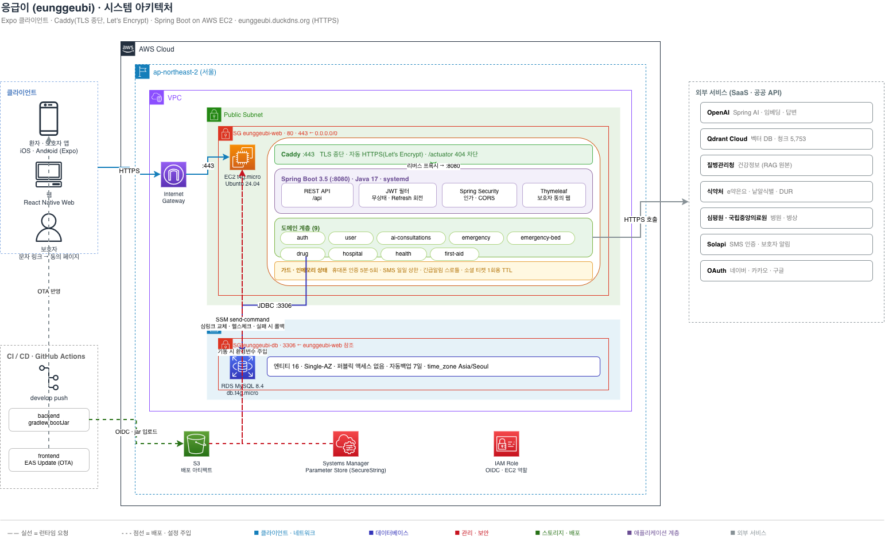

# 응급이 (eunggeubi)

급할 때 뭘 해야 할지 모르는 순간을 위한 앱 — 증상을 적으면 질병관리청 자료를 근거로 참고정보를 안내하고, 가까운 응급실의 남은 병상·약물 병용 확인·119 호출·보호자 자동 알림까지 한 흐름으로 이어집니다.

## 프로젝트 소개

**개발 기간** · 2026.07.03 ~ 진행 중
**진행** · 동아리 타닥타닥
**팀** · 5인 (백엔드 · 프론트엔드)

<!-- 기획 배경: 타겟 사용자 확정 후 변경 가능. 회의 후 최종 확정 예정 -->

갑작스러운 증상이 생겼을 때 옆에서 챙겨줄 사람 없이 혼자 판단해야 하는 경우가 늘고 있습니다. 특히 새벽이나 주말처럼 병원 상담이 어려운 시간대에는 "지금 병원에 가야 하나, 조금 더 지켜봐도 되나"를 스스로 결정해야 합니다.

이때 흔히 쓰는 포털 검색은 정보가 여러 곳에 흩어져 있고 출처가 제각각이라, 무엇을 믿어야 할지 가리는 데 다시 시간이 듭니다. AI 챗봇은 대화형으로 필요한 내용을 빠르게 좁혀준다는 장점이 있지만, 근거와 출처가 함께 제시되지 않으면 그 답을 그대로 신뢰하기 어렵습니다.

응급이는 이 간극을 메우는 것을 목표로 합니다. 공식 의료 가이드라인에 근거한 AI 정보 안내로 대화의 속도를 유지하면서 출처를 함께 제시하고, 가까운 응급실 탐색과 보호자 연락까지 하나의 흐름으로 묶었습니다. 사용자의 판단을 대신하는 것이 아니라, 판단에 필요한 정보를 한자리에 모으는 것이 목표입니다.

**전체 플로우**: 증상 입력 → AI 참고정보(RAG) → 가까운 응급실·병상 확인 → 119 호출 → 보호자에게 위치 문자

클라이언트는 Expo(React Native) 기반으로 iOS · Android · Web을 함께 지원합니다.

## 주요 기능

기능별 트러블슈팅은 프로젝트 마무리 후 위키에 정리할 예정입니다.

| 기능 | 요약 | 담당 |
|---|---|---|
| 인증 / 계정 | 회원가입·로그인(JWT), 휴대폰 인증(SMS), 소셜 로그인(네이버·카카오·구글), 아이디 찾기·비밀번호 재설정, 미성년자 보호자 동의 | 함한솔 |
| 회원 / 마이페이지 · 긴급 호출 | 회원정보 수정·비밀번호 변경·회원 탈퇴, 보호자 등록·동의 관리, 건강 프로필, 119 길게 누르기 호출, 보호자에게 현재 위치·상황 문자 발송 | 정수민 |
| AI 상담 · 응급처치 안내 | 증상 입력 → 질병관리청 건강정보 RAG 검색 → 근거·출처와 함께 참고정보 제공, 체크리스트, 상담 이력, 상황별 응급처치 가이드 | 김준휘 |
| 응급실 / 병상 · 의료기관 찾기 | 실시간 가용 병상 조회, 가까운 응급실 추천, 병원·약국 검색, 지도 표시, 상세 정보·진료과목 | 박하은 |
| 약물 정보 | 의약품 검색, 낱알 식별, 병용금기(DUR) 확인 | 강지호 |

## 기술 스택

**Frontend**


**Backend**


**Data**


**Infra**


**외부 연동** · 질병관리청 · 식약처 · 심평원 · 국립중앙의료원 · Solapi · 네이버/카카오/구글 OAuth


## 시스템 아키텍처

클라이언트는 HTTPS로 Caddy에 접속하고, Caddy가 TLS를 종단한 뒤 같은 EC2 안의 Spring Boot로 전달합니다. 애플리케이션은 `127.0.0.1:8080`에만 바인딩되어 외부에서 직접 접근할 수 없고, 모든 요청이 Caddy를 거칩니다. `/actuator/*`는 Caddy에서 404로 막아 헬스체크 엔드포인트가 밖으로 드러나지 않습니다.

데이터베이스는 퍼블릭 액세스 없이 보안그룹 참조로 웹 서버에서만 접근할 수 있고, 애플리케이션 시크릿은 서버에 평문으로 두지 않고 기동할 때마다 Parameter Store(SecureString)에서 주입됩니다.

OpenAI·공공데이터·SMS·소셜 로그인 등 외부 연동은 모두 서버가 대행합니다. 클라이언트에는 외부 API 키가 내려가지 않습니다.




## 시작하기

로컬 실행에는 **JDK 17 · Node 24 · MySQL 8** 이 필요합니다.

```bash
cd backend && ./gradlew bootRun --args='--spring.profiles.active=local'
```

```bash
cd frontend && npm install && npm start
```

`npm start`는 현재 PC의 LAN IP를 자동으로 찾아 `EXPO_PUBLIC_API_BASE_URL`에 넣어줍니다. 실기기(Expo Go)에서는 `localhost`로 로컬 백엔드에 접속할 수 없기 때문입니다.


## 팀

| 이름 | GitHub | 담당 파트 |
|---|---|---|
| 함한솔 | [@h-ns-l0](https://github.com/h-ns-l0) | 인증 · 소셜로그인 · 휴대폰 인증 · 보호자 동의 · AWS 인프라 · CI/CD |
| 정수민 | [@SO0omin](https://github.com/SO0omin) | 마이페이지 · 회원·건강 프로필 · 긴급 호출 · 보호자 알림 |
| 김준휘 | [@junhwi44](https://github.com/junhwi44) | AI 상담(RAG) · 응급처치 안내 |
| 박하은 | [@mintsilver](https://github.com/mintsilver) | 응급실·병상 조회 · 의료기관 찾기 · 지도 |
| 강지호 | [@hyojajiho](https://github.com/hyojajiho) | 약물 정보 · 낱알 식별 · 병용금기(DUR) |
